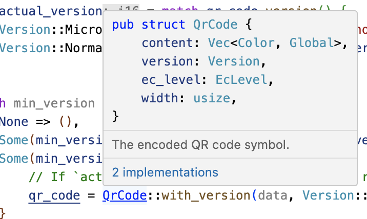

# Visual Studio Code

Rust 코드에서는 타입이 생략되므로 우수한 IDE가 C++보다 훨씬 더 유용해집니다. Visual Studio Code는 Chromium의 Rust에서 잘 작동합니다. 사용하려면 다음을 실행합니다.

- VSCode에 이전 형태의 Rust 지원이 아닌 `rust-analyzer` 확장 프로그램이 있는지 확인하세요.
- `gn gen out/Debug --export-rust-project`(또는 출력 디렉터리에 상응)
- `ln -s out/Debug/rust-project.json rust-project.json`

> **발표자 노트**
>
> 누군가가 IDE에 대해 회의적인 경우 rust-analyzer의 코드 주석 및 탐색 기능 중 일부를 시연해 보면 생각을 바꾸는데 유용할 수 있습니다.
>
> 다음 단계는 데모에 도움이 될 수 있습니다. 하지만 가장 익숙한 Chromium 관련 Rust를 대신 사용해도 됩니다.
>
> - `components/qr_code_generator/qr_code_generator_ffi_glue.rs`를 엽니다.
> - 커서를 `qr_code_generator_ffi_glue.rs의 \`QrCode::new\` 호출(26번 줄 부근) 위로 이동합니다.
> - 데모 **문서 표시**(일반적인 바인딩: vscode = ctrl k i; vim/CoC = K)
> - 데모 **정의로 이동**(일반적인 바인딩: vscode = F12; vim/CoC = g d) 그러면 `//third_party/rust/.../qr_code-.../src/lib.rs`로 이동합니다.
> - **개요** 데모를 실행하고 `QrCode::with_bits` 메서드(164번 줄 근처, 개요는 vscode의 파일 탐색기 창에 있음, 일반적인 vim/CoC 바인딩 = space o)로 이동합니다.
> - 데모 **유형 주석**(`QrCode::with_bits` 메서드에 몇 가지 좋은 예가 있음)
>
> `BUILD.gn` 파일을 수정한 후 `gn gen ... --export-rust-project`를 다시 실행해야 한다는 점은 주목할 필요가 있습니다. 이 작업은 이 세션의 연습 전반에 걸쳐 몇 번 반복하게 됩니다.
