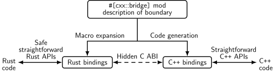

# C++와의 상호운용성

Rust 커뮤니티는 C++/Rust 상호 운용성을 위한 여러 옵션을 제공하며, 새로운 도구가 계속 개발되고 있습니다. 현재 Chromium은 CXX라는 도구를 사용합니다.

인터페이스 정의 언어(Rust와 매우 유사함)에서 전체 언어 경계를 설명하면 CXX 도구가 Rust 및 C++ 모두에서 함수와 유형에 관한 선언을 생성합니다.

See the [CXX tutorial](https://cxx.rs/tutorial.html) for a full example of using this.

> **발표자 노트**
>
> 다이어그램을 통해 설명합니다. 내부적으로는 이전과 동일한 작업을 실행한다고 설명합니다. 프로세스를 자동화하면 다음과 같은 이점이 있습니다.
>
> - 이 도구는 C++와 Rust 측의 일치를 보장합니다. 예를 들어 `#[cxx::bridge]`가 실제 C++ 또는 Rust 정의와 일치하지 않는 경우 컴파일 오류가 발생하지만 동기화되지 않은 수동 바인딩을 사용하면 정의되지 않은 동작이 발생합니다.
> - 이 도구는 비 C 기능의 FFI thunk(소형, C-ABI 호환, 무료 함수) 생성을 자동화합니다(예: Rust 또는 C++ 메서드에 대한 FFI 호출 사용 설정, 수동 바인딩의 경우 이러한 최상위 무료 함수를 수동으로 작성해야 함).
> - 도구와 라이브러리는 핵심 유형 집합을 처리할 수 있습니다. 예를 들면 다음과 같습니다.
>   - `&[T]`는 특정 ABI나 메모리 레이아웃을 보장하지 않더라도 FFI 경계를 넘어 전달될 수 있습니다. 수동 바인딩을 사용하면 `std::span<T>` / `&[T]`는 수동으로 디스트럭처링해야 하고 포인터와 길이로 다시 빌드해야 합니다. 이는 각 언어가 빈 슬라이스를 약간 다르게 표현하는 점을 고려할 때 오류가 발생하기 쉽습니다.
>   - `std::unique_ptr<T>`, `std::shared_ptr<T>`, `Box` 등의 스마트 포인터가 기본적으로 지원됩니다. 수동 바인딩을 사용하면 C-ABI 호환 원시 포인터를 전달해야 하므로 전체 기간 및 메모리 안전 위험이 증가합니다.
>   - `rust::String` 및 `CxxString` 유형은 언어 간 문자열 표현의 차이를 이해하고 유지합니다. 예를 들어 `rust::String::lossy`는 UTF8이 아닌 입력에서 Rust 문자열을 빌드할 수 있고 `rust::String::c_str`은 문자열을 NUL 종료할 수 있습니다.
