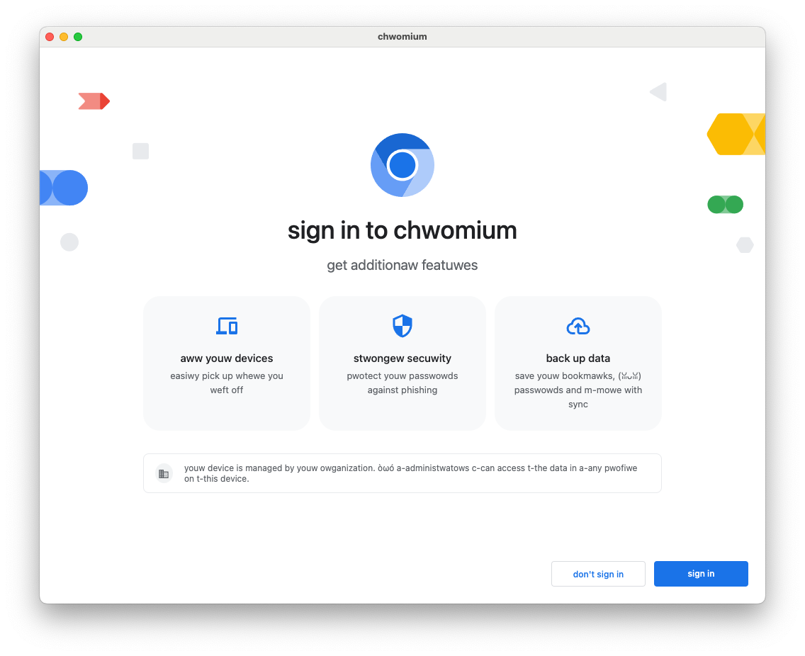

# Bringing It Together — Exercise

이 연습에서는 이미 학습한 모든 내용을 종합하는 완전히 새로운 Chromium 기능을 추가합니다.

## The Brief from Product Management

외딴 열대 우림에 사는 pixie 커뮤니티가 발견되었습니다. Pixie용 Chromium을 최대한 빨리 배송하는 것이 중요합니다.

Chromium의 모든 UI 문자열을 Pixie 언어로 번역해야 합니다.

제대로 번역될 때까지 기다릴 시간은 없지만, 다행히 pixie 언어는 영어와 매우 유사한 데다 번역을 하는 Rust 크레이트가 있습니다.

사실 [이전 연습에서 이 크레이트를 이미 가져왔습니다](https://crates.io/crates/uwuify).

물론 Chrome의 실제 번역 작업을 위해서는 상당한 주의와 노력이 필요합니다. 배송하지 마세요.

## 걸음수

표시하기 전에 모든 문자열을 uwuify하도록 `ResourceBundle::MaybeMangleLocalizedString`을 수정합니다. 이 특수 Chromium 빌드에서는 `mangle_localized_strings_`의 설정과 관계없이 항상 이 작업을 실행해야 합니다.

이 모든 연습에서 모든 작업을 제대로 완료했다면 축하합니다. pixie용 Chrome을 만드셨을 것입니다.

> **발표자 노트**
>
> Students will likely need some hints here. Hints include:
>
> - UTF16과 UTF8. 학생들은 Rust 문자열이 항상 UTF8이라는 점을 알고 있어야 하며, `base::UTF16ToUTF8`을 사용하여 C++ 측에서 변환을 실행하고 다시 그 반대로 변환하는 것이 더 낫다고 결정할 수 있습니다.
> - Rust 측에서 변환하기로 결정한 학생들은 [`String::from_utf16`](https://doc.rust-lang.org/std/string/struct.String.html#method.from_utf16)을 고려하고 오류 처리를 고려하고 [많은 u16을 전송할 수 있는 CXX 지원 유형](https://cxx.rs/binding/slice.html)을 고려해야 합니다.
> - 학생들은 여러 가지 방법으로 C++/Rust 경계를 설계할 수 있습니다. 예를 들어 값으로 문자열을 가져와 반환하거나 문자열에 대한 변경 가능한 참조를 사용할 수 있습니다. 변경 가능한 참조를 사용하면 CXX에서 학생에게[`Pin`](https://doc.rust-lang.org/std/pin/)을 사용해야 한다고 알릴 가능성이 높습니다. `Pin`의 역할을 설명하고 이것이 C++ 데이터에 대한 변경 가능한 참조를 위해 CXX에 필요한 이유를 설명해야 할 수도 있습니다. 대답은 C++ 데이터는 Rust 데이터처럼 이동할 수 없다는 것입니다. 자체 참조 포인터가 포함되어 있을 수 있기 때문입니다.
> - `ResourceBundle::MaybeMangleLocalizedString`이 포함된 C++ 타겟은 `rust_static_library` 타겟에 종속되어야 합니다. 학생은 이미 이를 실행했을 것입니다.
> - `rust_static_library` 타겟은 `//third_party/rust/uwuify/v0_2:lib`에 종속되어야 합니다.
