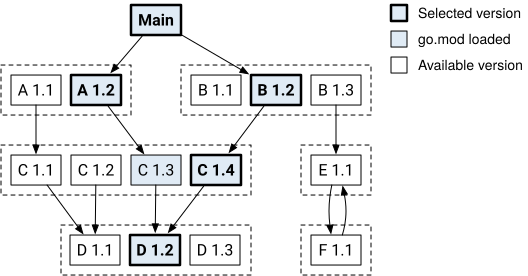
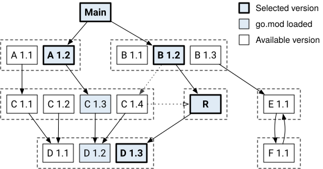
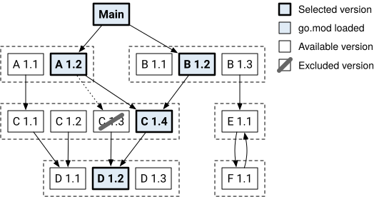
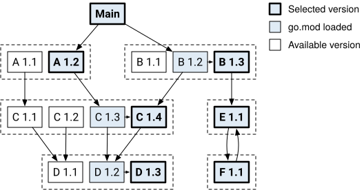
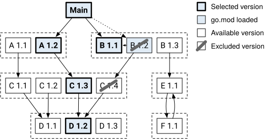

# Minimal version selection (MVS)

Go uses an algorithm called Minimal version selection (MVS) to select a set of module versions to use when building packages. MVS is described in detail in [Minimal Version Selection](https://research.swtch.com/vgo-mvs) by Russ Cox.

Conceptually, MVS operates on a directed graph of modules, specified with [`go.mod` files](glossary.md). Each vertex in the graph represents a module version. Each edge represents a minimum required version of a dependency, specified using a [`require`](go-mod-file.md#require-directive) directive. The graph may be modified by [`exclude`](go-mod-file.md#exclude-directive) and [`replace`](go-mod-file.md#replace-directive) directives in the `go.mod` file(s) of the main module(s) and by [`replace`](workspaces.md#replace-directive) directives in the `go.work` file.

MVS produces the [build list](glossary.md) as output, the list of module versions used for a build.

MVS starts at the main modules (special vertices in the graph that have no version) and traverses the graph, tracking the highest required version of each module. At the end of the traversal, the highest required versions comprise the build list: they are the minimum versions that satisfy all requirements.

The build list may be inspected with the command [`go list -m all`](mod-commands.md#go-list--m). Unlike other dependency management systems, the build list is not saved in a “lock” file. MVS is deterministic, and the build list doesn’t change when new versions of dependencies are released, so MVS is used to compute it at the beginning of every module-aware command.

Consider the example in the diagram below. The main module requires module A at version 1.2 or higher and module B at version 1.2 or higher. A 1.2 and B 1.2 require C 1.3 and C 1.4, respectively. C 1.3 and C 1.4 both require D 1.2.

MVS visits and loads the `go.mod` file for each of the module versions highlighted in blue. At the end of the graph traversal, MVS returns a build list containing the bolded versions: A 1.2, B 1.2, C 1.4, and D 1.2. Note that higher versions of B and D are available but MVS does not select them, since nothing requires them.

### Replacement

The content of a module (including its `go.mod` file) may be replaced using a [`replace` directive](go-mod-file.md#replace-directive) in a main module’s `go.mod` file or a workspace’s `go.work` file. A `replace` directive may apply to a specific version of a module or to all versions of a module.

Replacements change the module graph, since a replacement module may have different dependencies than replaced versions.

Consider the example below, where C 1.4 has been replaced with R. R depends on D 1.3 instead of D 1.2, so MVS returns a build list containing A 1.2, B 1.2, C 1.4 (replaced with R), and D 1.3.

### Exclusion

A module may also be excluded at specific versions using an [`exclude` directive](go-mod-file.md#exclude-directive) in the main module’s `go.mod` file.

Exclusions also change the module graph. When a version is excluded, it is removed from the module graph, and requirements on it are redirected to the next higher version.

Consider the example below. C 1.3 has been excluded. MVS will act as if A 1.2 required C 1.4 (the next higher version) instead of C 1.3.

### Upgrades

The [`go get`](mod-commands.md#go-get) command may be used to upgrade a set of modules. To perform an upgrade, the `go` command changes the module graph before running MVS by adding edges from visited versions to upgraded versions.

Consider the example below. Module B may be upgraded from 1.2 to 1.3, C may be upgraded from 1.3 to 1.4, and D may be upgraded from 1.2 to 1.3.

Upgrades (and downgrades) may add or remove indirect dependencies. In this case, E 1.1 and F 1.1 appear in the build list after the upgrade, since E 1.1 is required by B 1.3.

To preserve upgrades, the `go` command updates the requirements in `go.mod`. It will change the requirement on B to version 1.3. It will also add requirements on C 1.4 and D 1.3 with `// indirect` comments, since those versions would not be selected otherwise.

### Downgrade

The [`go get`](mod-commands.md#go-get) command may also be used to downgrade a set of modules. To perform a downgrade, the `go` command changes the module graph by removing versions above the downgraded versions. It also removes versions of other modules that depend on removed versions, since they may not be compatible with the downgraded versions of their dependencies. If the main module requires a module version removed by downgrading, the requirement is changed to a previous version that has not been removed. If no previous version is available, the requirement is dropped.

Consider the example below. Suppose that a problem was found with C 1.4, so we downgrade to C 1.3. C 1.4 is removed from the module graph. B 1.2 is also removed, since it requires C 1.4 or higher. The main module’s requirement on B is changed to 1.1.

[`go get`](mod-commands.md#go-get) can also remove dependencies entirely, using an `@none` suffix after an argument. This works similarly to a downgrade. All versions of the named module are removed from the module graph.
