# return expressions

[expr.return](#r-expr.return)

# `return` expressions

[expr.return.syntax](#r-expr.return.syntax)

**Syntax**\
[ReturnExpression](#railroad-ReturnExpression) → return [Expression](../expressions.md#grammar-Expression)?

Show Railroad

 [expr.return.intro](#r-expr.return.intro)

Return expressions are denoted with the keyword `return`.

[expr.return.behavior](#r-expr.return.behavior)

Evaluating a `return` expression moves its argument into the designated output location for the current function call, destroys the current function activation frame, and transfers control to the caller frame.

[expr.return.diverging](#r-expr.return.diverging)

A `return` expression is [diverging](../divergence.md#r-divergence) and has a type of [`!`](../types/never.md#r-type.never).

An example of a `return` expression:

``` playground
#![allow(unused)]
fn main() {
fn max(a: i32, b: i32) -> i32 {
    if a > b {
        return a;
    }
    return b;
}
}
```
